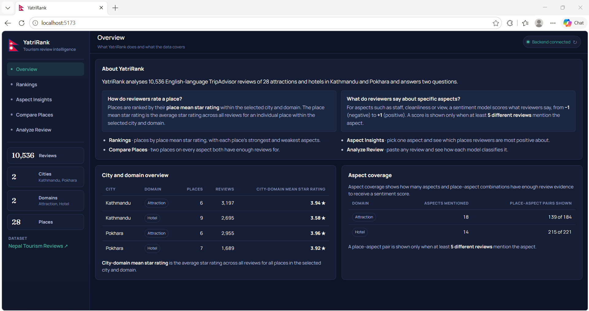
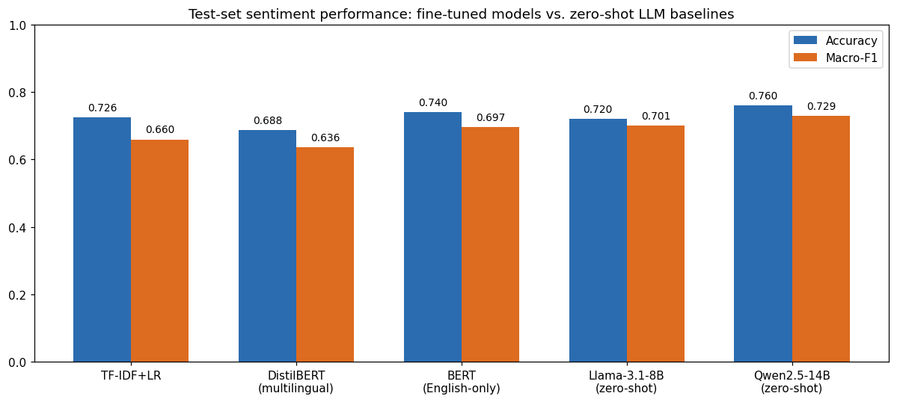
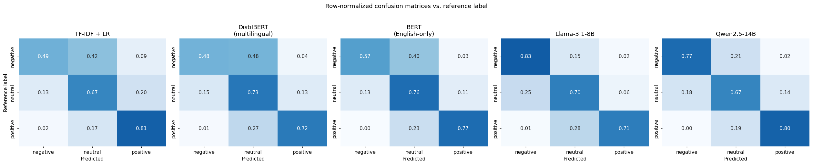
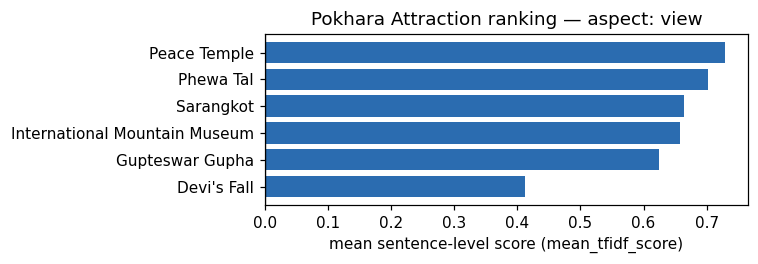
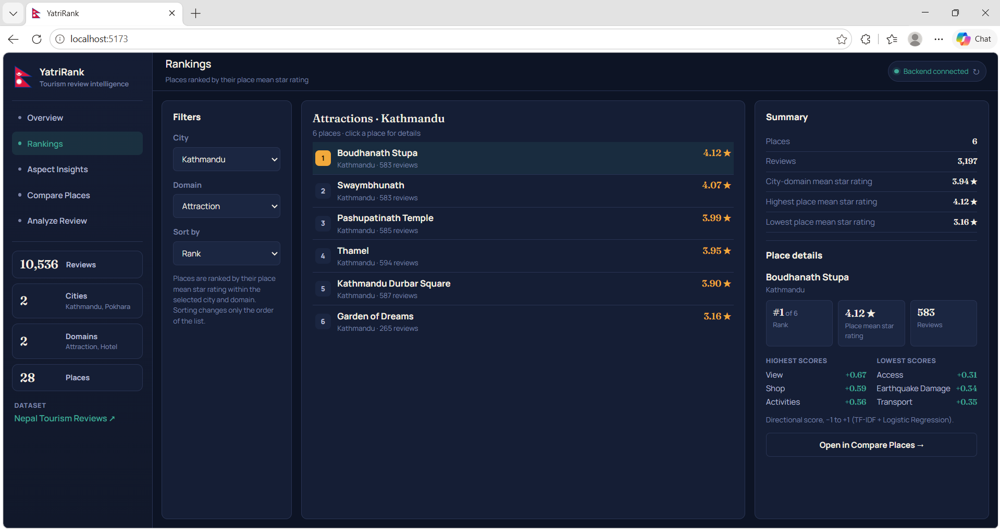
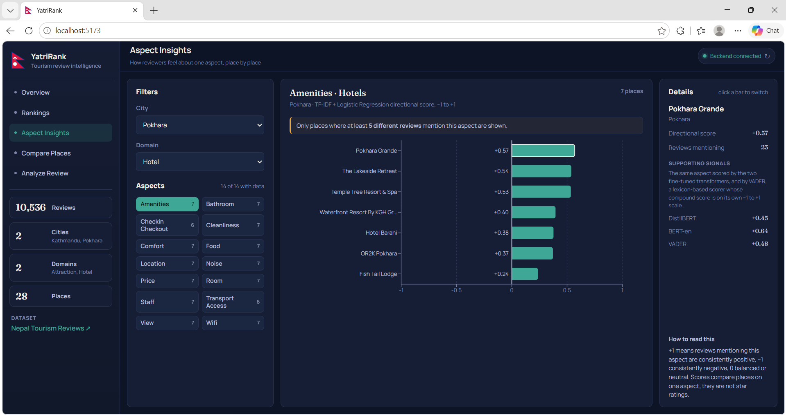
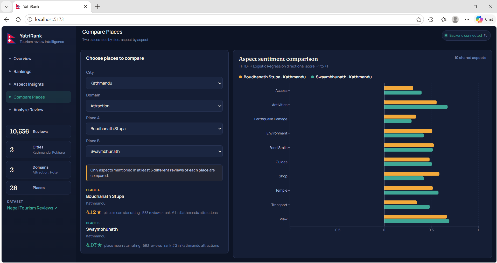
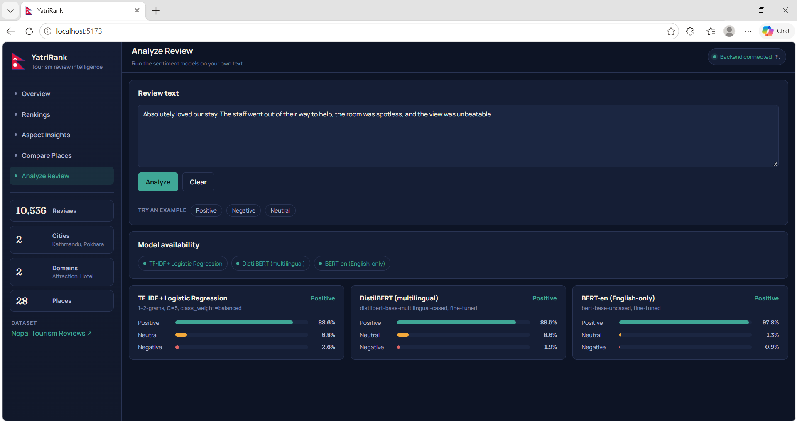

# YatriRank

Review sentiment prediction and aspect-based ranking of hotels and attractions in Kathmandu and Pokhara, Nepal.

YatriRank has two parts:

- **`notebook.ipynb`** trains and evaluates the sentiment models, scores aspects (staff, cleanliness, view, …) and
  exports every result to `models/` and `outputs/`.
- **A web app** (FastAPI backend + React/Vite frontend) serves those saved results and runs the saved models on new
  text. The app does not re-derive anything: every number it shows comes from a file the notebook exported or
  from the notebook's saved models.



## Dataset

[Nepal Tourism Reviews](https://www.kaggle.com/datasets/pratiktimilsina/nepal-tourism-reviews) on Kaggle: 10,536
English TripAdvisor reviews of 28 places (Kathmandu and Pokhara × Hotel and Attraction). Each review's 1–5 star rating
gives the reference label (1–2 negative, 3 neutral, 4–5 positive). The dataset also contains zero-shot labels from
Llama-3.1-8B-Instruct and Qwen2.5-14B-Instruct, which the notebook evaluates but never trains on.

## Method

1. **Cleaning.** A light clean (Unicode normalisation; URL, e-mail and HTML removal; repeated characters shortened)
   for the transformers, and a deep clean (light clean, lower-casing, special-character removal, POS-aware
   lemmatisation) for TF-IDF.
2. **Split.** Place-grouped split within each city × domain (5,872 train / 1,675 validation / 2,989 test reviews),
   so no place appears in more than one split.
3. **Models.** TF-IDF + Logistic Regression (grid-searched on validation macro-F1, refit on train+validation), and
   fine-tuned `distilbert-base-multilingual-cased` and `bert-base-uncased` with class-weighted loss (4 epochs, best
   epoch kept by validation macro-F1).
4. **Evaluation.** The three trained models and the two zero-shot LLMs (whose labels come with the dataset) are
   compared on the same test set, with place-cluster bootstrap 95% CIs and Holm-corrected pairwise cluster
   permutation tests.
5. **Aspects.** Reviews are split into sentences and then into clauses at contrast words ("but", "however", …).
   Clauses matching an aspect's keywords are scored by the three models as P(positive) − P(negative), and by VADER's
   compound score, all from −1 to +1. TF-IDF + LR is the primary score; the others are supporting signals. Scores are
   averaged per review, then per place and aspect. A place–aspect score is reported only when at least 5 different
   reviews mention the aspect.

## Results (test set, 2,989 reviews from 8 held-out places)

| Model | Accuracy (95% CI) | Macro-F1 (95% CI) |
|---|---|---|
| TF-IDF + LR | 0.726 (0.657–0.806) | 0.660 (0.585–0.750) |
| DistilBERT (multilingual), fine-tuned | 0.688 (0.580–0.803) | 0.636 (0.543–0.742) |
| BERT (English), fine-tuned | 0.740 (0.646–0.838) | 0.697 (0.612–0.786) |
| Llama-3.1-8B, zero-shot | 0.720 (0.627–0.815) | 0.701 (0.636–0.770) |
| Qwen2.5-14B, zero-shot | 0.760 (0.696–0.826) | 0.729 (0.687–0.774) |

CIs are place-cluster bootstrap intervals. After Holm correction, no pairwise accuracy difference is significant at
p < 0.05 (`outputs/metrics/cluster_significance.json`).



**Per-class F1.** Positive is the easiest class for every model. TF-IDF + LR and the two fine-tuned transformers
score lowest on negative reviews, while the zero-shot LLMs score lowest on neutral and are clearly best on negative.

| Model | Negative | Neutral | Positive |
|---|---|---|---|
| TF-IDF + LR | 0.523 | 0.620 | 0.837 |
| DistilBERT | 0.515 | 0.596 | 0.798 |
| BERT-en | 0.606 | 0.647 | 0.837 |
| Llama-3.1-8B | 0.683 | 0.608 | 0.811 |
| Qwen2.5-14B | 0.699 | 0.636 | 0.853 |



**By city and domain.** TF-IDF + LR is more accurate on hotels (Kathmandu 0.838, Pokhara 0.825) than on attractions
(Kathmandu 0.717, Pokhara 0.617).

**Agreement between models.** Cohen's κ is highest between the two LLMs (0.786) and lowest between TF-IDF + LR and
Llama (0.526).

**Hard cases.** All five models disagree with the reference label on 260 test reviews (8.7%,
`outputs/metrics/hard_cases_all_wrong.csv`). Negative labels are over-represented among them (20.0% vs 13.3% of the
test set), and 4-star reviews are the largest group (114 of 260).

## Aspect analysis

- 9,470 of 10,536 reviews (89.9%) mention at least one aspect, giving 36,614 aspect–clause pairs over 14 hotel and
  18 attraction aspects. 289 pairs were dropped because the clause names a different place.
- The result is 405 place–aspect scores (`outputs/rankings/aspect_aggregate.csv`); the web app reports those backed
  by at least 5 reviews.
- The four scorers agree moderately to strongly: DistilBERT and BERT-en correlate at 0.836, each correlates with
  TF-IDF + LR at about 0.79, and VADER correlates with the others at 0.59–0.66.
- `outputs/figures/` has one chart per city × domain × aspect with enough data (58 in total), for example:



## The web app

### Rankings



### Aspect Insights



### Compare Places



### Analyze Review



### Where the web app's numbers come from

| Page | What it shows | Source |
|---|---|---|
| Overview | Review, place and group totals; city-domain mean star rating | `outputs/rankings/overall_place_ranking.csv` |
| Overview | Aspect coverage | `outputs/rankings/aspect_aggregate.csv` |
| Rankings | Places ranked by mean star rating | `overall_place_ranking.csv` |
| Rankings | A place's highest- and lowest-scoring aspects | `aspect_aggregate.csv` (`mean_tfidf_score`) |
| Aspect Insights | Places ranked on one aspect; DistilBERT, BERT-en and VADER as supporting scores | `aspect_aggregate.csv` |
| Compare Places | Two places' star ratings, review counts and ranks; their shared aspects, side by side | `overall_place_ranking.csv` and `aspect_aggregate.csv` |
| Analyze Review | Live predictions on pasted text | `models/` (TF-IDF + LR, DistilBERT, BERT-en) |

The backend only aggregates, ranks and sorts for display (counts, sums, review-weighted means). The Llama and Qwen
labels are not run in the app.

## Notebook outputs

| File | Contents |
|---|---|
| `outputs/rankings/overall_place_ranking.csv` | Mean star rating and review count per place (used by the app) |
| `outputs/rankings/aspect_aggregate.csv` | Mean aspect score per place from all four scorers (used by the app) |
| `outputs/rankings/aspect_clauses.csv` | Every aspect–clause pair with its four scores |
| `outputs/rankings/aspect_directional_rankings.csv` | Top 3 places per domain × aspect, both cities pooled (5+ reviews) |
| `outputs/metrics/five_way_benchmark.json` | Accuracy, macro-F1, CIs, per-class reports, κ, city/domain breakdown |
| `outputs/metrics/cluster_significance.json` | Pairwise accuracy differences, CIs, raw and Holm p-values |
| `outputs/metrics/test_predictions.csv` | Test set with all five models' predictions |
| `outputs/metrics/hard_cases_all_wrong.csv` | Test reviews that all five models got wrong |
| `outputs/metrics/split_assignments.csv` | Train / validation / test assignment of every review |
| `outputs/metrics/aspect_pipeline_summary.json` | Aspect coverage, pair counts, scorer correlations |
| `outputs/metrics/environment.txt` | Full `pip freeze` of the training environment |
| `outputs/figures/` | Model comparison, confusion matrices, 58 aspect ranking charts |

## Project structure

```
YatriRank/
├── notebook.ipynb          # training, evaluation and aspect pipeline (run on Kaggle, GPU)
├── verify_consistency.py   # checks dataset/, models/ and outputs/ against the notebook and the backend
├── readme_numbers.py       # derives every result quoted in this README from outputs/
├── dataset/                # nepal_tourism_reviews.csv (not in the repo; download from Kaggle; not read by the app)
├── models/                 # exported by the notebook (transformer weights not in the repo, see below)
├── outputs/                # exported by the notebook: figures/, metrics/, rankings/
├── docs/screenshots/       # web app screenshots used in this README
├── backend/                # FastAPI app (main.py) and pinned requirements
└── frontend/               # React + Vite app
```

## Running it locally

**1. Get the model weights.** `outputs/` and the TF-IDF + LR model are in the repo, but the two transformer weight
files (`model.safetensors`) are too large for GitHub. Run `notebook.ipynb` on Kaggle (GPU T4, Internet on, with the
Nepal Tourism Reviews dataset added as input; `CSV_PATH` in the first code cell points to it), then copy
`/kaggle/working/models` and `/kaggle/working/outputs` into the project root, replacing both folders so that the
models and outputs come from the same run. A re-run on a GPU is not guaranteed to be bit-identical, so its numbers
may differ slightly from the ones reported here. The training-time `training_args.bin` files are also left out of the
repo, since nothing needs them to run.

The dataset is not in the repo either, because it is published on Kaggle. To run the verification script, download
`nepal_tourism_reviews.csv` from the Kaggle dataset into `dataset/`.

**2. Backend.** Python 3.10–3.12 (training used 3.12; tested locally on 3.10). From the project root:

```
python -m venv .venv
.venv\Scripts\activate                 # macOS/Linux: source .venv/bin/activate
pip install -r backend/requirements.txt
python -m nltk.downloader punkt punkt_tab wordnet averaged_perceptron_tagger averaged_perceptron_tagger_eng
cd backend
uvicorn main:app --port 8000
```

`requirements.txt` pins scikit-learn, transformers, torch, nltk and numpy to the training versions. The saved models
depend on them, so don't loosen those pins.

**3. Frontend.** Requires Node.js. In a second terminal, from the project root:

```
cd frontend
npm install
npm run dev
```

Open http://localhost:5173. To use a different backend address, set `VITE_API_BASE_URL` in `frontend/.env`; to allow
a different frontend origin, set `YATRIRANK_CORS_ORIGINS` (comma-separated) for the backend.

## Verifying consistency

```
python verify_consistency.py            # data, rankings, metrics, figures, model files, versions
python verify_consistency.py --models   # also re-runs all three models on the test set through backend/main.py
```

The `--models` run confirms that the backend's cleaning and saved models reproduce the notebook's test predictions
exactly (all three agree at 100%). On a CPU, it takes several minutes; add `--n 300` for a quicker sample. The
script's expected values are the numbers from the run reported here, so after a re-run of the notebook some checks
will fail until `EXPECTED` at the top of the script is updated.

```
python readme_numbers.py                # prints every result quoted in this README, from outputs/ only
```

## Limitations

- **Reference labels come from star ratings**, not from annotating the text, so a review's text and its rating can
  disagree. Of the 260 test reviews that all five models get wrong, 114 are 4-star.
- **The test set has 8 places.** The split holds out whole places to avoid leakage, so the confidence intervals are
  wide and the model differences are not statistically significant.
- **Aspect scores are exploratory.** Aspects are found by keyword matching, and the aspect analysis scores all
  10,536 reviews, including those the models were trained on (72% for TF-IDF + LR, 56% for the transformers). The
  aspect rankings are directional, not validated measurements.
- **English reviews only.** The multilingual DistilBERT was trained and tested on English text here.
